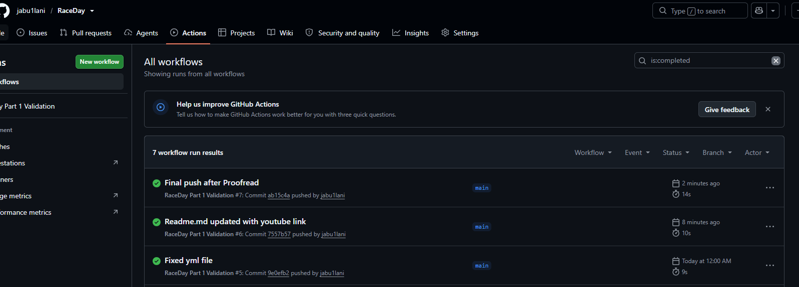
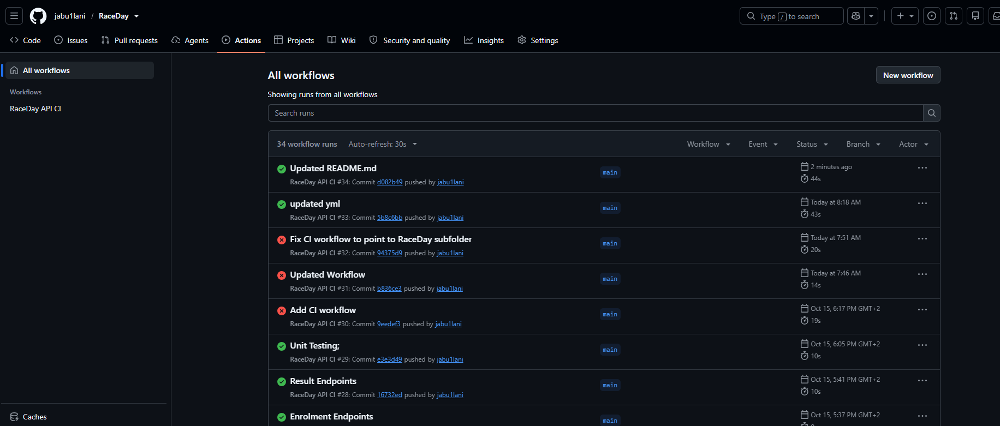
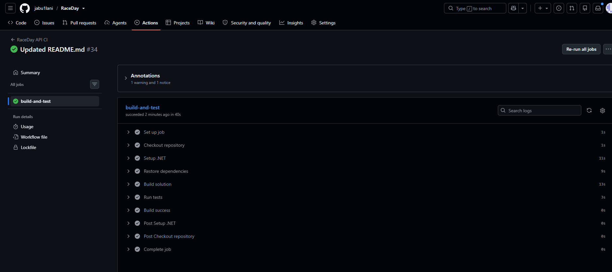

# RaceDay - Event Management System

## Part 1: System Planning and Database

### Overview
RaceDay is a full-stack web-based event management system designed for the South African road running, walking, and cycling community.

### Project Description
RaceDay is a full-stack web-based event management system designed specifically for the South African road running, walking, and cycling community. The platform addresses the challenges faced by event organisers who still rely on paper-based registration, spreadsheets, and disconnected communication channels.

The Problem: Despite South Africa's rich road events culture—from the iconic Comrades Marathon to the Cape Town Cycle Tour, Soweto Marathon, and hundreds of community events—many organisers struggle with manual registration processes, fragmented participant management, and inadequate race-day preparation tools.

The Solution: RaceDay provides a centralised digital platform where Event Organisers can create and manage events, categories, and participant results, while Participants can browse upcoming events, register, track their personal performance history, and prepare for race day using live weather and route information.

### Participant
Participants are the end-users who engage with events on the platform. Their capabilities include:

Event Discovery: Browse all upcoming events with filtering by province and date

Event Registration: Enrol in events and select specific categories (e.g., 10km Run or 42km Marathon)

Payment Tracking: Monitor payment status for enrolments

Performance History: View personal results across all events, including:

- Finish times

- Overall and category positions

- Race numbers

Race-Day Preparation: Access live weather information and route details for upcoming events

Profile Management: Update personal information and view enrolment history

### Documentation
- **ERD**: `docs/(updated) ERD matches sql.png` - Entity Relationship Diagram
- **API Plan**: `docs/Raceday_API_Endpoint_Plan.pdf` - Complete API endpoint specifications
- **Database Script**: `docs\Raceday-database.sql` - SQL Server schema and seed data

### Database Schema
- 8 core tables (Role, User, Event, Category, EventCategory, Enrolment, Result, Weather)
- 3 views for common queries
- 2 stored procedures for common operations
- 4 triggers for data integrity

### Features Implemented
- Role-based user management (Administrator, Organiser, Participant)
- Event creation and management
- Category management for events
- Participant enrolment system
- Results tracking and leaderboards
- Weather information for events

### Video Walkthrough
[Part 1 Submission Video](https://youtu.be/02skAj9lkx0)

### Repository Structure

raceday/
├── docs/
│ ├── erd.png
│ ├── Raceday_API_Endpoint-Plan.md
│ └── Raceday-database.sql
├── .github/
│ └── workflows/
│ └── validate.yml
└── README.md

# RaceDay Event Management System

## Project Description
RaceDay is a full-stack event management system for the South African road running, walking, and cycling community.

## User Roles

### Organiser
- Create, update and delete their own events
- Manage categories and entry fees
- View and manage enrolments
- Record race results

### Participant
- Browse events and categories
- Enrol in events
- View their own race results

## Part 1 - Planning
- [ERD](docs/RaceDay_ERD.pdf)
- [API Endpoint Plan](docs/RaceDay_API_Endpoint_Plan.pdf)
- [SQL Database Script](docs/RaceDay_Database.sql)

## Part 2 - RESTful API

### Technologies Used
- ASP.NET Core 8 Web API
- Entity Framework Core (Code First)
- SQL Server
- Swagger / OpenAPI
- xUnit for testing

### Project Structure

RaceDay/
├── docs/
├── RaceDay.Api/
│ ├── Controllers/
│ ├── Data/
│ ├── Filters/
│ ├── Models/
│ ├── Services/
│ └── Program.cs
├── RaceDay.Contracts/
│ └── Dtos.cs
├── RaceDay.Api.Tests/
└── .github/workflows/ci.yml

### Database Setup
1. Ensure SQL Server is running.
2. Update the connection string in `appsettings.json`.
3. Open Package Manager Console and run:
        Add-Migration InitialRaceDayDatabase
        Update-Database

### How to Run the API
1. Open the solution in Visual Studio 2022.
2. Set `RaceDay.Api` as startup project.
3. Press `F5` to run.
4. Swagger UI opens automatically at `/swagger`.

### Authentication
- Register via `POST /api/auth/register`
- Login via `POST /api/auth/login`
- Session stores UserId and Role

### API Endpoints
| Method | Route | Role |
|--------|-------|------|
| POST | /api/auth/register | Public |
| POST | /api/auth/login | Public |
| POST | /api/auth/logout | Any |
| GET | /api/profile/me | Authenticated |
| PUT | /api/profile/me | Authenticated |
| GET | /api/events | Public |
| POST | /api/events | Organiser |
| PUT | /api/events/{id} | Organiser (owner) |
| DELETE | /api/events/{id} | Organiser (owner) |
| POST | /api/enrolments | Participant |
| GET | /api/enrolments/mine | Participant |
| POST | /api/results | Organiser |
| GET | /api/results/mine | Participant |

### Swagger
Swagger is available at `/swagger` when the API is running.

### Unit Testing
All tests pass locally and in CI.

CI/CD
GitHub Actions workflow: .github/workflows/ci.yml

Restores packages
Builds solution
Runs all tests

Video Presentation
Part 2 Video - Unlisted [https://youtu.be/1aMQDMCdT60?si=Nse8FNQyMNqHDlQQ]